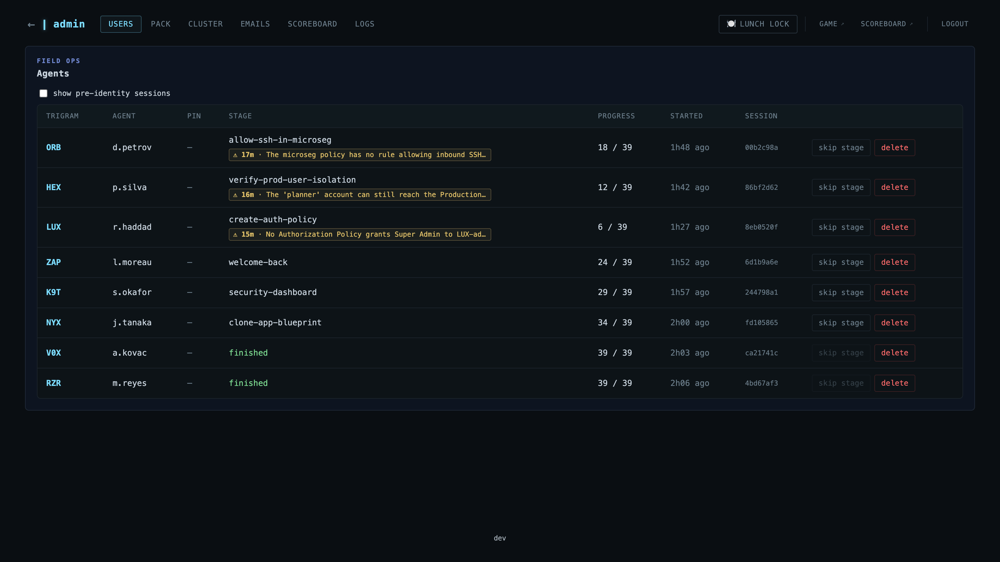

# Operator guide

Host the **NCP Infiltration Game** on a dedicated lab.

The blueprint also includes **NKP Fundamentals (experimental)**, which is outside the scope of this guide.

## Before you start

Book one **dedicated HPoC cluster** using the custom runbook (**4 nodes for the full game**, or a single node with unsupported stages skipped):

- **AOS and Prism Central 7.5.x**. Do not select 7.6 for this game.
- **NCM Self-Service** and **Flow Network Security (microsegmentation)** enabled.
- Flow Networking, Advanced networking and Leap available.
- **Intelligent Operations** enabled for the report and automation stages.

Use `hpoc` for a dedicated lab, including a single-node HPoC. On a 4-node HPoC, installation removes one node for players to add back; on a single node, removal is skipped and the expansion stage is unavailable.

Use `other` for shared clusters, where HPoC-only operations are skipped. The full installer still prepares networks, users and VMs. For an existing training world, see the optional [deployment-only variant](DEPLOYMENT_NOTES.md#shared-clusters-and-existing-installations).

## Install

Download `nig-00-runbook-prerequisites.json` and `nig-01-blueprint.json` from the [latest release](https://github.com/r0w/ntnx-infiltration-game/releases/latest).

1. Prepare the HPoC with the prerequisites above.
2. Use a project named **lab**, with the cluster and **primary** subnet configured. Create it if needed.
3. Import and run the prerequisites runbook in `lab`, with **Target project** set to `lab`. It creates the **AD** endpoint; use a UPN for the AD username.
4. Import the blueprint into the **same project**, select **NCP**, and launch with the settings below.
5. Once the app is **running**, retrieve the URLs from its description. Confirm **Policy Engine** activation before the approval-policy stages.

### Launch settings

| Field | Value |
|---|---|
| Cluster profile | `hpoc` for a dedicated lab (single-node or 4-node); `other` for a shared cluster |
| Run mode | `live` for an event, `test` for a rehearsal |
| NUTANIX credential | Game VM SSH account: keep username `nutanix`, set its password |
| Secondary network name | `secondary` for HPoC; the existing lab VLAN for `other` |
| Image tag | `latest` or a release tag; `develop` for the development build |

Supply the PC IP and local admin credentials, select the **primary** subnet for the game VM and set the event's time zone. Keep the other defaults, including the pre-filled Planner password.

Share these links once installation is complete:

- Players: `https://game.<vm-ip>.sslip.io/`
- Projector: `https://game.<vm-ip>.sslip.io/scoreboard`
- Operator: `https://game.<vm-ip>.sslip.io/admin`

Fresh deployments generate this address from the VM IP automatically: no DNS record or VDI configuration is needed. Accept the local certificate warning in the browser (Advanced → Proceed). Test this once from a player VDI: its DNS must resolve sslip.io to private IPs and its browser policy must allow the certificate exception. The VM must accept TCP 80/443; HTTP on the generated hostname redirects to HTTPS. Caddy keeps its CA and certificates in Docker volumes across restarts and game updates. No public certificate authority is contacted.

Port 3000 remains available for existing operational tools and combined-scoreboard peers (`http://<vm-ip>:3000`); use these HTTP peer URLs because servers cannot click through a certificate warning. HTTPS does not by itself guarantee browser clipboard permissions.

Players also need the Prism Central URL, lab credentials and internet access.

## Run the session

Open `/admin`. The default password is **`nutanix/4u`**; change it with `ADMIN_PASSWORD`.

| Control | Use it to |
|---|---|
| Agents | Follow progress, inspect failed checks, skip a stage or delete a session |
| Pack | Enable or disable stages, choose gates and adjust help costs |
| Gates | Hold players at a stage, then unlock the room |
| Lunch lock | Pause the room; resume when everyone returns |
| Export / import config | Reuse stage, gate and help-cost settings across instances |
| Scoreboard | Configure the projection or combine several instances |
| Emails | Send invitations and lab summaries through Mailtrap |

Disabling a stage can affect later stages: review the dependency list in the confirmation. Importing a configuration replaces the existing settings.

### Help

**Help is off by default in `live` and `test`, and on in `mock`.** Enable it with the help button in the admin header. The **Help** menu for each player can follow the global setting or override it on/off.

On supported stages, players click **Guide me, Tank.** or type `?` to open an illustrated guide. They can navigate the steps, copy values, enlarge captures and drag an enlarged image to explore it.

Set each stage's penalty in **Pack → HELP COST**. Players confirm before the first charged display; reopening the same guide does not charge again. Changes to the cost apply to future first uses, not help already charged. The Agents table and scoreboard show help usage and penalties.

### Scoring

Ranking uses **playing time plus help penalties**. Time spent at an operator gate or under the lunch lock is excluded. Technical troubleshooting time is not automatically deducted.

Scoreboard status: **paused** for a gate, **lunch** for the room lock, and **idle** after a minute without an attempt.

## Modes and updates

| Mode | Behavior |
|---|---|
| `live` | Real cluster, normal pacing, developer tools hidden |
| `test` | Real cluster, developer tools and auto-play available |
| `mock` | Simulated cluster, developer tools and help enabled by default |

`test` and `mock` default to instant text and no pauses; players can change these in the developer panel. Auto-play in `test` performs real cluster actions.

In **Self-Service → Apps**, the NCP blueprint provides:

- **Update Game**: pull the selected image and restart; sessions persist.
- **Switch Mode**: change between `live`, `test` and `mock` on the same instance.
- **Verify State**: check the prepared cluster (full installer only).

Use a separate instance and data directory for a mock alongside a real game; Switch Mode changes the existing instance. Update and rehearse before an event.

## Troubleshooting and reference

- [Project setup, Policy Engine, subnet migration and shared-cluster deployment](DEPLOYMENT_NOTES.md).
- [Blueprint development and compilation](../tooling/blueprint/README.md).
- [Stage list](STAGES.md).
- [7.6 project/category investigation](https://github.com/r0w/ntnx-infiltration-game/blob/7.7/docs/PROJECT_CATEGORY_COMPATIBILITY.md): preserved on branch `7.7`; compatibility with that future version remains unconfirmed.
